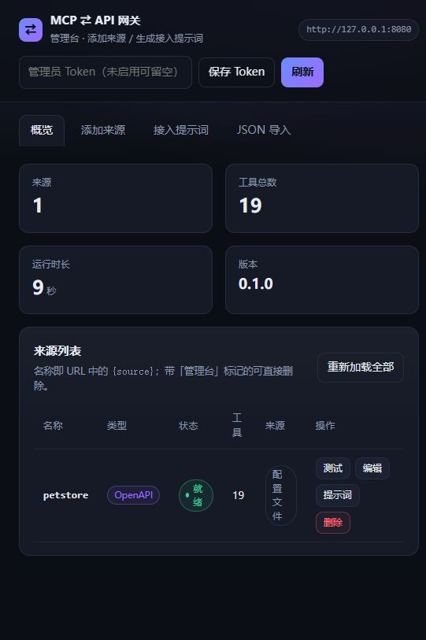

# MCP ⇄ API Bridge

[](https://github.com/dtyg123/mcp-api-bridge/actions/workflows/ci.yml)
[](LICENSE)
[](package.json)
[](https://github.com/dtyg123/mcp-api-bridge/pkgs/container/mcp-api-bridge)

A bidirectional MCP ⇄ API gateway. Expose any MCP server as a REST/OpenAPI service,
or turn any OpenAPI / Swagger 2.0 service into an MCP server — in one process, one
Docker image, with a web admin UI for adding sources. TypeScript, no database, no build
step for the UI.

一个**双向协议网关**：把 MCP Server 变成 REST/OpenAPI 接口，也把 REST/OpenAPI 服务变成 MCP Server。
TypeScript 实现，单进程、单个 Docker 镜像、HTTP 与 stdio 双形态。



**特性**

- **双向**：MCP → REST/OpenAPI，API → MCP，同一份注册表同时对外提供两套接口
- **输出即端点**：来源（MCP / OpenAPI）只是素材，真正的对外接口是「输出」——一个输出可组合多个来源、裁掉不需要的工具、选 MCP 和/或 API 形态
- **三种形态**：`convert` 逐工具转换（`{source}__{tool}`）、`mirror` 保持 MCP 上游工具名、`proxy` 按上游路径原样转发（网关仍解析协议，不暴露上游地址与凭证）
- **文档通吃**：OpenAPI 3.0 / 3.1，以及**自动转换的 Swagger 2.0**（`in: body`、`definitions`、`securityDefinitions`，实测雨云 API 217 个操作）
- **零配置接入**：`spec` 支持 URL / 本地文件 / 粘贴文本，`$ref` 自动内联（含外部引用、JSON/YAML）
- **Web 管理台**：可视化添加来源、一键导入、编辑输出并复制现成的 MCP 配置 / curl / AI 提示词；逐项测试接口、管理可复用的「认证信息」、在输出上按字段映射编排返回数据
- **数据编排**：响应到达调用方前重新组装——挑字段、改名、补当前时间 / 固定文本 / 计数，无需改上游或写代码；规则挂在输出上，同时控制该输出的 MCP `structuredContent` 与 REST `data`
- **原生 MCP**：Streamable HTTP（stateful / stateless）、每个输出一个端点 `/mcp/{output}`、stdio 模式
- **部署友好**：单镜像、非 root、健康检查、`data/` 卷持久化、环境变量插值，上游挂了网关照常启动（降级）

```
                    ┌──────────────────────────────────────────┐
  MCP 客户端         │              mcp-api-bridge              │        REST 客户端
  (Claude Desktop,  │                                          │        (curl, Postman,
   Cursor, Cline,   │   POST /mcp/{output}     Streamable HTTP │         ChatGPT Actions,
   Agent, ...)  ────┼──►  (MCP 协议)            │◄────   自研服务, ...)
                    │                                          │
                    │   GET  /openapi/{output}.json  输出的文档  │
                    │   POST /api/{output}/{tool}   (REST 调用)  │
                    └───────────────┬──────────────────────────┘
                                    │
              ┌─────────────────────┴──────────────────────┐
              │                                            │
      MCP Server（stdio / Streamable HTTP / SSE）    OpenAPI / Swagger 服务（HTTP + JSON）
```

两个方向**同时可用**：一个输出可以从多个来源取工具，同时对外提供 MCP 和 REST 两套接口。

| 形态 | 输入 | 输出 | 典型用途 |
| --- | --- | --- | --- |
| **MCP → API** | 来源里的 MCP Server（stdio / http / sse） | `POST /api/{output}/{tool}` + `/openapi/{output}.json` | 让不支持 MCP 的系统（脚本、低代码平台、Actions）调用 MCP 工具 |
| **API → MCP** | 来源里的 OpenAPI 3.x / Swagger 2.0 文档（URL 或本地文件） | `POST /mcp/{output}`（Streamable HTTP）、`--stdio` | 把已有业务 API 直接接入 Claude / Cursor / Agent |

---

## 快速开始

### Docker Compose（推荐）

```bash
cp bridge.config.example.yaml bridge.config.yaml   # 然后按需修改
docker compose up -d --build
curl http://localhost:8080/health
```

### Docker

```bash
docker build -t mcp-api-bridge:latest .

docker run -d --name mcp-bridge \
  -p 8080:8080 \
  -v "$PWD/bridge.config.yaml:/app/bridge.config.yaml:ro" \
  -v "$PWD/data:/app/data" \
  -e PUBLIC_BASE_URL=http://localhost:8080 \
  mcp-api-bridge:latest
```

也可以直接用发布镜像（打 tag 后自动构建）：

```bash
docker run -d --name mcp-bridge -p 8080:8080 \
  -v "$PWD/bridge.config.yaml:/app/bridge.config.yaml:ro" \
  -v "$PWD/data:/app/data" \
  ghcr.io/dtyg123/mcp-api-bridge:latest
```

### 本地运行

```bash
npm install
npm run build
node dist/src/index.js --config bridge.config.example.yaml
```

启动后：

```
GET  /health                    健康检查
GET  /openapi/{output}.json     该输出的 OpenAPI 文档
POST /api/{output}/{tool}       调用工具（body = 工具参数）
GET  /api/{output}/{tool}       调用工具（query = 工具参数，适合简单工具）
POST /api/{output}/*            proxy 输出的原样透传入口
POST /mcp/{output}              该输出的 MCP 端点（Streamable HTTP）
GET  /admin                     Web 管理台（添加来源 / 编辑输出 / 测试）
POST /admin/reload              重新加载 spec / 刷新上游工具列表
GET  /admin/api/outputs         输出列表（含工具数、端点 URL）
POST /admin/api/outputs         新建 / 更新输出
DELETE /admin/api/outputs/:name 删除输出
GET  /admin/api/outputs/:name/prompt  该输出的 AI 接入提示词
POST /admin/api/import          一键导入（MCP 客户端配置 / OpenAPI 文档 / 启动命令）
GET  /admin/api/credentials     认证信息列表（值已掩码）
POST /admin/api/credentials     新增 / 更新认证信息
GET  /admin/api/transforms?output=  某输出的数据编排列表
PUT  /admin/api/transforms      保存某输出 / 来源 / 接口的编排
POST /admin/api/transforms/preview   用示例响应试算编排（不保存）
GET  /admin/api/sources/:kind/:name/discover?tool=  探测某接口返回，递归列出可用字段路径（用于编排）
```

---

## Web 管理台（`/admin`）

启动后打开 `http://localhost:8080/admin`，不用写 YAML 就能接入来源：

| 页面 | 作用 |
| --- | --- |
| **概览** | 来源列表：类型、状态、工具数、被哪些输出使用；每行可「打开 / 编辑 / 删除」，点来源名也能进入工作台 |
| **来源** | 三种添加方式切换：**MCP**（stdio / Streamable HTTP / SSE）、**OpenAPI**、**一键导入**（粘贴 MCP 客户端配置、OpenAPI/Swagger 文档或 URL、或一条启动命令）。OpenAPI 文档只需一个输入框：填 URL / 本地路径，或直接粘贴 JSON/YAML（自动识别）。保存后**立即生效**。认证统一为**勾选全局凭证**（可多选）；「高级选项」里可配置额外请求头、过滤和超时。页面底部有「🔑 全局凭证」卡片（请求头 / Bearer / Basic，值掩码显示），新建时可「按文档填入」自动取到 `securitySchemes` 的请求头名 |
| **输出** | 对外发布的一套端点。一个输出可以：组合多个来源、逐来源勾选要暴露的工具（全不勾 = 全部）、选择形态（MCP / API）、选择模式：**转换**（`{source}__{tool}`）、**镜像**（保持上游 MCP 工具名）、**原样透传**（按上游路径转发，仅限 1 个 OpenAPI 来源）。编辑输出时展开「数据编排」即可按来源 / 接口配置返回字段；**转换**和**镜像**输出同时作用于 MCP 与 API，**原样透传**不应用编排。每张卡片都能一键复制 MCP 客户端配置、curl 示例和整份 AI 提示词 |
| **工作台** | 选中一个来源后逐项调接口：填参数、看真实响应、**临时切换凭证**。这里只发原始调用，编排在「输出」里配置 |

几个关键设计：

- 管理台新增的来源和输出写入 `data/managed-sources.json`（`server.admin.storeFile` / `BRIDGE_DATA_DIR` 可改位置），**不会改写** `bridge.config.yaml`；同名条目以管理台版本为准，所以也能「接管」手写来源。
- 删除：管理台来源直接移除；配置文件里声明的来源会记录到 `managed-sources.json` 的 `excludes` 并从运行中的网关隐藏（**不改你的 YAML，重启后仍生效**），重新以同名添加即可恢复。
- 「粘贴文档」方式添加 OpenAPI 时，文档会保存到 `data/specs/`，重启后依然可用。
- 「全局凭证」和「数据编排」分别持久化到 `data/credentials.json`、`data/transforms.json`（与 `managed-sources.json` 同目录），同样依赖挂载的 `data/` 卷。
- 提示词里的端点、鉴权、工具清单都来自当前运行状态，复制即可粘给 Claude / Cursor / ChatGPT 等工具。

> 公网部署务必设置 `server.adminToken`（或 `BRIDGE_ADMIN_TOKEN`），否则任何能访问 `/admin` 的人都能增删来源。页面里的 Token 只保存在浏览器 localStorage。

Docker 部署时记得挂载数据目录，否则容器重建后管理台新增的来源会丢：

```yaml
volumes:
  - ./bridge.config.yaml:/app/bridge.config.yaml:ro
  - ./data:/app/data
```

---

## 用法一：把 MCP Server 变成 REST API

配置里加上 MCP Server：

```yaml
mcpServers:
  - name: filesystem
    transport:
      type: stdio
      command: npx
      args: ["-y", "@modelcontextprotocol/server-filesystem", "/data"]

  - name: remote
    transport:
      type: http                       # 也支持 type: sse
      url: https://example.com/mcp
      headers:
        Authorization: Bearer ${REMOTE_MCP_TOKEN}
```

每个来源首次出现时会自动生成一个同名输出（转换模式、MCP + API、全部工具），所以上面的例子直接可用 `/api/filesystem/read_file`、`/mcp/filesystem`。要裁剪工具或组合来源，在管理台「输出」里改（或写 `outputs:`，见「配置说明」）。

调用：

```bash
# POST：body 就是工具参数
curl -X POST http://localhost:8080/api/filesystem/read_file \
  -H 'content-type: application/json' \
  -d '{"path":"/data/notes.md"}'

# GET：参数放 query（仅当参数都是基础类型时）
curl 'http://localhost:8080/api/filesystem/read_file?path=/data/notes.md'
```

返回统一封装：

```json
{
  "ok": true,
  "source": "filesystem",
  "tool": "read_file",
  "name": "filesystem__read_file",
  "isError": false,
  "text": "文件内容……",
  "data": "文件内容……",
  "content": [{ "type": "text", "text": "文件内容……" }],
  "meta": { "source": "filesystem", "tool": "read_file" }
}
```

- `content` 是原始 MCP 内容块（text / image / resource …），不做信息丢失
- `data` 是结构化载荷：`structuredContent`，或能被 JSON 解析的文本，否则为原文
- 配置了「数据编排」时，`data` / `text` 会被积木重新组装，并附带 `transformed: true`（详见下文）
- 工具级失败（MCP `isError: true`）返回 **HTTP 200 + `ok: false`**，与 MCP 语义一致；网关级错误用 400 / 404 / 502
- 同时 `GET /openapi/{output}.json` 会生成该输出的 OpenAPI 文档，可直接导入 Postman、Dify、ChatGPT Actions 等

---

## 用法二：把 OpenAPI 服务变成 MCP Server

```yaml
apis:
  - name: petstore
    spec: https://petstore3.swagger.io/api/v3/openapi.json
    baseUrl: https://petstore3.swagger.io/api/v3    # 可选，覆盖 servers[0].url
    headers:
      User-Agent: mcp-api-bridge
    include: ["GET /pet/*"]      # 可选：只暴露部分操作，支持 * 通配
    exclude: ["DELETE /pet/*"]   # 可选：排除操作
    security:                    # 可选：按 securitySchemes 注入凭证
      ApiKeyAuth: { token: ${PETSTORE_KEY} }
      BearerAuth: { token: ${PETSTORE_TOKEN} }
      BasicAuth:  { username: admin, password: ${PETSTORE_PASS} }
```

`spec` 可以是 URL、绝对路径，或相对配置文件所在目录的路径（JSON / YAML 均可，支持 `$ref` 内联，含外部引用）。

**Swagger 2.0 会自动转换**：文档里写 `"swagger": "2.0"`（`in: body` 请求体、`definitions`、`securityDefinitions`、`host`/`basePath`/`schemes`）也能直接接入，网关在内存里转成 OpenAPI 3.1 后再生成工具，不需要事先跑 `swagger2openapi`。例如雨云 API：

```yaml
apis:
  - name: rainyun
    spec: https://api.rainyun.com/openapi.json       # Swagger 2.0，217 个操作
    security:
      ApiKey: { token: ${RAINYUN_API_KEY} }          # -> 请求头 X-Api-Key
```

接入后每个操作一个工具，例如 `POST /product/domain/register` 变成 `rainyun__registerDomain`（未写 `operationId` 时命名为 `post_product_domain_register`），`in: body` 里的字段（`domain`、`duration`、`type`……）会直接展开成工具的入参。

### 接入 MCP 客户端

Streamable HTTP（Claude Desktop、Cursor、Cline、自研 Agent 等）：

```json
{
  "mcpServers": {
    "petstore": {
      "type": "http",
      "url": "http://localhost:8080/mcp/petstore",
      "headers": { "Authorization": "Bearer <BRIDGE_MCP_TOKEN>" }
    }
  }
}
```

`/mcp/{output}` 中的 `{output}` 是输出名。默认输出与来源同名，所以 `petstore` 来源就是 `/mcp/petstore`；在管理台新建输出后换成新名字即可。

### stdio 模式

同一个镜像也能作为本地 stdio MCP Server 使用：

```bash
docker run -i --rm \
  -v "$PWD/bridge.config.yaml:/app/bridge.config.yaml:ro" \
  mcp-api-bridge:latest --stdio
```

```json
{
  "mcpServers": {
    "bridge": {
      "command": "docker",
      "args": ["run", "-i", "--rm", "-v", "/abs/bridge.config.yaml:/app/bridge.config.yaml:ro", "mcp-api-bridge:latest", "--stdio"]
    }
  }
}
```

---

## 认证信息（可复用凭证）

管理台「来源」页底部的「🔑 全局凭证」卡片把密钥集中保存成**命名凭证**，来源只需按名称引用。轮换密钥时改一处，所有引用它的来源立即生效，不用重写配置。

| 类型 | 生成的请求头 | 字段 |
| --- | --- | --- |
| `header` | `<key>: <value>` | `key`（如 `X-Api-Key`）、`value` |
| `bearer` | `Authorization: Bearer <value>` | `value` |
| `basic` | `Authorization: Basic base64(user:pass)` | `username`、`password` |

列表接口永远只返回掩码（`se••••23`）；编辑时留空表示「保持原值」。凭证保存在 `data/credentials.json`，引用关系可以写进 YAML：

```yaml
apis:
  - name: rainyun
    spec: https://api.rainyun.com/openapi.json
    credentialRefs: [rainyun, rainyun-backup]   # 可引用多个凭证
    headers:                                     # 显式请求头优先，同名（忽略大小写）只保留一份
      User-Agent: mcp-api-bridge
```

管理台新增 / 编辑来源时直接勾选凭证即可。**同一来源可引用多个凭证**，默认全部合并（同名头以后者为准）：

- 「工作台 → 接口测试」有「凭证」下拉，可对单次测试临时切换（仅后台）。
- 输出开启「允许调用方切换凭证」后，REST 调用可在请求头带 `x-bridge-credential: <凭证名>`，只使用该输出里某个来源引用的凭证；未开启返回 403，未引用返回 400。MCP 面暂不支持按调用切换。
- 新建凭证时点「按文档方案填入」，会读取当前文档的 `securitySchemes`，自动填好请求头名（如 `X-Api-Key`）和类型。

## 输出访问令牌（隔离到单个输出）

「输出」编辑器里可以给这个输出配一个 token。配了之后，AI 只能拿到这组端点，改 URL 也越不过去：

| 入口 | 接受的 token |
| --- | --- |
| `/mcp/{output}`、`/api/{output}/**`、`/openapi/{output}.json` | 该输出的 token，或全局 `rest` / `mcp` token |

- 输出没配 token 时退回全局 token；两处都没配才是匿名可访问（默认，方便本地试）。
- 输出卡片上的「复制 AI 提示词」会自动带上该输出的 token。
- 只把这份提示词（或这份客户端配置）交给 AI，就能做到 token 级隔离：全局 token 相当于总钥匙，不要外发。

---

## 数据编排（字段映射）

「数据编排」在响应到达调用方之前重新组装数据：挑出需要的字段、改名、补上当前时间或固定文本，适合把上游的原始响应整理成前端 / AI 直接可用的形状。

配置以 `output + source + tool` 为键（`tool: "*"` 是该输出里该来源全部接口的默认规则），保存在 `data/transforms.json`。它同时作用于该输出的 **MCP 面**（`structuredContent` 与文本）和 **REST 面**（`/api/{output}/{tool}` 的 `data` / `text`）；`proxy`（原样透传）输出不应用编排。同一个工具通过两个输出发布时，可以有两个完全不同的返回形状。

### 管理台怎么用

打开「输出 → 编辑」，展开 **数据编排**：

1. 选「来源 / 接口」→ 点 **🔍 探测字段**：后端会真实调用一次该接口（无参，best-effort），把返回 JSON 递归展开成一条条字段路径，例如 `data[].Title`、`code`。数组元素会标成 `data[].xxx` 方便逐条映射。来源和接口只能从当前输出里挑选（已被裁剪掉的工具不会出现）。
2. 左侧「可用字段」里每条后面点 **＋** 就加到右侧「编排输出」；也可以手动填路径添加自定义字段。
3. 右侧每条都能改**输出名（自定义，明亮显示）**，并能补「当前时间 / 固定值 / 模板文本」这类计算字段。
4. 想省事就点 **🚀 快速编排**：把左侧所有字段**原样照搬**到右侧（输出名默认取末级字段名），之后再挑着改。
5. 底部「示例响应」+「预览」可实时试算；「保存编排」后才生效。没探测到字段时，快速编排会自动开启「保留原字段（passthrough）」。

> 编排是随输出保存的：先保存输出，再配置编排。旧的按来源保存的编排没有 `output` 字段，升级后会被忽略（不兼容旧格式）。

### 配置格式（也可直接写 JSON）

```json
{
  "root": "data",
  "passthrough": false,
  "blocks": [
    { "op": "field", "from": "Title", "as": "title" },
    { "op": "field", "from": "TimeStamp", "as": "time" },
    { "op": "count", "from": "", "as": "total" },
    { "op": "now", "as": "fetchedAt", "format": "iso" }
  ]
}
```

对应 REST 返回：

```json
{
  "ok": true,
  "source": "petstore",
  "tool": "get_news",
  "transformed": true,
  "data": {
    "title": "……",
    "time": "2026-10-04T09:52:13.654Z",
    "total": 10,
    "fetchedAt": "2026-11-01T04:08:37.457Z"
  }
}
```

支持的算子（`op`）：

| 算子（`op`） | 作用 | 参数 | 管理台 |
| --- | --- | --- | --- |
| `field` | 取一个字段，可改名 | `from`、`as`（留空 = 同名） | ✅ 字段映射 |
| `text` | 模板文本，`{{path}}` 用数据填充 | `as`、`template` | ✅ 计算字段 |
| `constant` | 固定值（字符串 / 数字 / JSON 对象） | `as`、`value` | ✅ 计算字段 |
| `now` | 当前时间 | `as`、`format`（`iso` / `date` / `time` / `timestamp` / `locale`）、`offsetSeconds` | ✅ 计算字段 |
| `count` | 数组长度 / 对象键数 | `from`、`as` | 仅 JSON / API |
| `join` | 把数组拼成字符串 | `from`、`as`、`separator` | 仅 JSON / API |
| `omit` | 删掉一个字段（配合 `passthrough`） | `from` | 仅 JSON / API |
| `each` | 对数组每个元素执行一组子积木 | `from`、`as`、`blocks` | 仅 JSON / API |

几点约定：

- `root` 为空表示整个 `data` 载荷；`from` 留空表示「当前根」，所以 `root` 指向数组时可以用 `count` / `each` 直接处理整个数组。
- 没被选中的字段默认丢弃；`passthrough: true` 保留原字段，再用 `omit` 删掉敏感字段。
- 子积木最多嵌套 5 层；每层的路径都相对于它处理的那个元素。
- 编排本身出错不会吞掉响应：REST 封装里会带 `transformed: false` 和 `transformError`，同时仍然返回原数据；MCP 面则回退为上游原始结果。
- 管理台「工作台 → 接口测试」始终调用原始工具，不应用输出上的编排。

---

## 配置说明

```yaml
server:
  host: 0.0.0.0
  port: 8080
  publicBaseUrl: ${PUBLIC_BASE_URL:-}   # 生成 /openapi/{output}.json 里的 servers[0].url
  basePath: ""                          # 全局路径前缀，例如 /bridge
  cors: true
  bodyLimit: 10mb
  auth:
    rest: ${BRIDGE_REST_TOKEN:-}        # /api/{output}、/openapi/{output}.json 的全局 token
    mcp: ${BRIDGE_MCP_TOKEN:-}          # /mcp/{output} 的全局 token
  adminToken: ${BRIDGE_ADMIN_TOKEN:-}   # /admin 管理台与 /admin/api/**
  admin:
    enabled: true                       # false = 完全关闭管理台
    path: /admin
    storeFile: ./data/managed-sources.json   # 管理台新增的来源 / 输出（相对配置文件目录）
    specsDir: ./data/specs                   # 「粘贴 OpenAPI 文档」的存放目录
  mcp:
    path: /mcp
    sessionMode: stateful               # stateful | stateless
    jsonResponse: false                 # true = 用 JSON 响应替代 SSE 流
  rest:
    path: /api

outputs:                                # 对外发布的端点（管理台里的改动写入 data 文件）
  - name: everything
    mode: convert                       # convert | mirror | proxy
    form: [mcp, api]                    # convert 可双形态；mirror 仅 mcp；proxy 仅 api
    sources:
      - source: filesystem              # tools 留空 = 该来源全部工具
      - source: petstore
        tools: [listPets, getPetById]   # 只暴露这些工具
    token: ${OUTPUT_TOKEN:-}            # 可选；留空回退全局 token
    allowCredentialSwitch: false

openapi:
  version: "3.1"                        # 3.1 | 3.0
  title: MCP Bridge API

logging:
  level: info                           # debug | info | warn | error
  format: text                          # text | json
```

- 字符串值支持 `${VAR}` 与 `${VAR:-默认值}` 环境变量插值，敏感信息不必写进文件
- `auth.*` 留空表示不启用全局 token；填值后需 `Authorization: Bearer <token>`（或 `x-api-key`）
- `outputs[]` 决定对外的端点、工具裁剪和鉴权。来源第一次出现会自动生成同名默认输出（转换、MCP + API、全部工具）；管理台对输出 / 来源的修改写入 `storeFile`，不改你的 YAML
- `exposure` 只影响 stdio 模式与 `--list-tools` 的工具清单，不再影响 HTTP 端点（HTTP 由 `outputs` 决定）
- `sessionMode: stateless` 时每个请求独立建连，适合多副本无状态部署
- `server.adminToken` 只保护管理台；留空时管理台完全开放（启动日志会警告）

环境变量：`BRIDGE_CONFIG`、`PORT`、`HOST`、`PUBLIC_BASE_URL`、`LOG_LEVEL`、`BRIDGE_REST_TOKEN`、`BRIDGE_MCP_TOKEN`、`BRIDGE_ADMIN_TOKEN`、`BRIDGE_DATA_DIR`。
优先级：命令行参数 > 配置文件 > 环境变量 > 默认值。

---

## 转换规则

### API → MCP（OpenAPI 操作 → 工具）

| 规则 | 说明 |
| --- | --- |
| 工具名 | `{source}__{operationId}`，非法字符替换为 `_`，超过 64 字符自动加哈希后缀；重名追加 `_2` |
| 参数 | `path` / `query` / `header` / `cookie` 参数合并到顶层对象；描述前加 `(path)`、`(query)` 等标记 |
| 请求体 | JSON 对象体直接**展开**到顶层（`body.name` → `name`），与参数重名时自动加 `body_` 前缀；数组/字符串等非对象体放进 `body` |
| 必填 | `path` 参数恒为必填；`requestBody.required` 为真时其 `required` 字段才生效 |
| 组合 schema | `$defs` / `definitions` 提升到根级并重写 `$ref` |
| 鉴权 | 按 `securitySchemes` + `security` 自动注入 `Authorization` / `x-api-key` / query / cookie |
| Swagger 2.0 | `in: body` / `in: formData` 先转成 `requestBody`，`definitions` → `components.schemas`，`securityDefinitions` → `securitySchemes`，`collectionFormat` → `style`/`explode`，`host`+`basePath`+`schemes` → `servers[0].url` |
| 媒体类型 | `application/json`、`+json`、`x-www-form-urlencoded`、`multipart/form-data`、`text/*`、二进制 |
| 响应 | JSON → text 内容块 + `structuredContent`；图片 → `image` 内容块；其余 → 文本（超过 200 KB 截断） |

### MCP → API（工具 → OpenAPI）

| 规则 | 说明 |
| --- | --- |
| 路径 | `{rest.path}/{output}/{tool.name}`（转换模式为 `{source}__{tool}`，镜像模式为上游工具名） |
| 方法 | 每个工具生成 `POST`（body = 参数对象）；参数均为基础类型时额外生成 `GET`（query 参数） |
| Schema | MCP `inputSchema` 原样作为 `requestBody` schema，`$defs` 提升到 `components.schemas` |
| 响应 | 统一 `BridgeToolResult` 封装（`ok` / `isError` / `text` / `data` / `content`） |
| 版本 | `?version=3.0` 可即时获取 3.0 版本（`nullable`、`exclusiveMinimum`、`$ref` 兄弟节点等自动降级） |

---

## 命令行

```
--config <path>     配置文件（YAML/JSON），默认 ./bridge.config.yaml 或 $BRIDGE_CONFIG
--host <host>       覆盖 server.host
--port <port>       覆盖 server.port
--stdio             以 stdio 方式提供 MCP（本地客户端用）
--list-tools        连接上游、打印工具清单后退出（自检用）
--print-config      打印合并后的配置
--log-level <lvl>   debug | info | warn | error
--version / --help
```

---

## 已知限制

- 只转发 MCP 的 **tools**；`resources` / `prompts` 暂未桥接
- 文档支持 OpenAPI 3.0 / 3.1 与 Swagger 2.0（自动转换；Swagger 1.x 会给出明确报错）。OpenAPI 3.2 尚未适配
- `multipart/form-data` 的文件字段：传普通字符串时按文本字段发送；需要真实文件时传 `{"filename":"a.png","contentType":"image/png","content":"<base64>"}`
- 会话默认保存在内存中；多副本部署请用 `sessionMode: stateless` 或做粘性会话
- 上游不可达时不影响网关启动，`/health` 会标记 `degraded`（`/health?strict=1` 返回 503）

---

## 开发

```bash
npm install
npm run build      # 编译到 dist/
npm test           # 编译 + 运行 node:test（含端到端：真实 MCP stdio 上游 + 模拟 REST 上游）
npm run dev        # tsx watch
```

```
src/
  index.ts                 CLI 入口（HTTP / stdio / 自检）
  config.ts                配置加载、环境变量插值、校验
  registry.ts              来源与工具注册表（热重载、命名去重、降级保留）
  convert/
    openapi-to-tools.ts    OpenAPI 操作 → MCP 工具（参数映射 + 请求构造 + 响应转换）
    tools-to-openapi.ts    MCP 工具 → OpenAPI 文档
    schema.ts               JSON Schema 提升 / 3.0 降级 / 对象化
  openapi/
    resolve.ts             $ref 内联（本地 + 外部、JSON/YAML、循环检测）
    loader.ts              文档加载、baseUrl 解析
  upstream/mcp.ts          MCP 客户端（stdio / Streamable HTTP / SSE）
  mcp/gateway.ts           聚合 MCP Server（动态 tools/list + tools/call）
  admin/
    store.ts               来源 / 输出持久化与热重载（managed-sources.json）
    credentials.ts         认证信息保险库（credentials.json）
    transforms.ts          数据编排积木引擎（transforms.json）
    service.ts             来源连通性测试
    prompts.ts             按输出生成接入提示词
  http/
    server.ts             Express 路由、鉴权、REST/RPC 封装
    mcp-endpoint.ts       Streamable HTTP 会话管理（stateful / stateless）
test/                      单元测试 + 端到端测试
```

## 贡献

欢迎 PR，开发约定见 [CONTRIBUTING.md](CONTRIBUTING.md)。安全漏洞请按 [SECURITY.md](SECURITY.md) 私下报告，不要开公开 Issue。

## License

MIT © [dtyg123](https://github.com/dtyg123)
